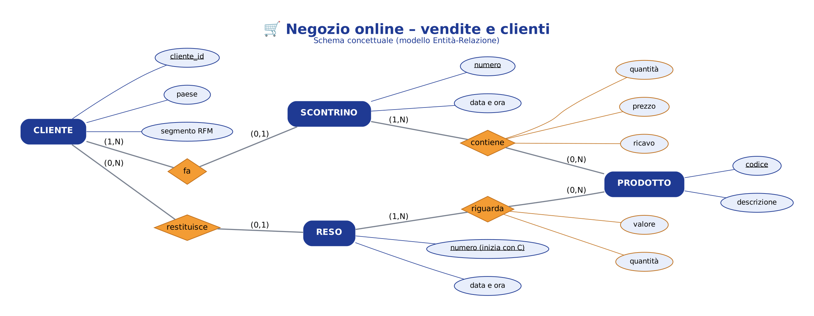
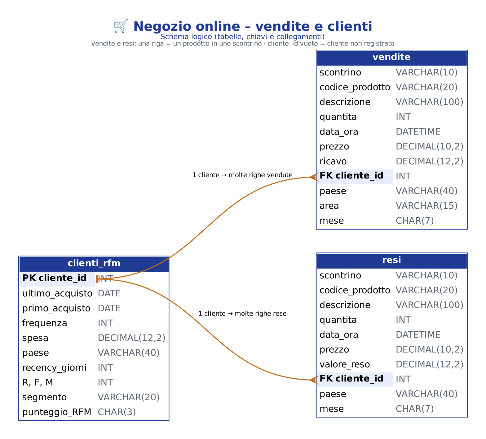

# 🛒 Negozio online – Vendite e clienti (dataset Online Retail II)

Progetto di **Francesco Autorino** – Data Analyst.

🛠️ Strumenti: **SQL · Python · Power BI**

📅 Dati: dicembre 2009 – dicembre 2011 · **1.067.371 righe** di vendita.

---

## 🧭 1. Il progetto in breve

🏪 Un negozio online inglese che vende articoli regalo. Molti clienti sono **grossisti**.

❓ **Le 6 domande**

1️⃣ 📈 Come vanno le vendite nel tempo?

2️⃣ 🏆 Quali prodotti e quali paesi portano più soldi?

3️⃣ 👑 Chi sono i clienti migliori? → analisi **RFM**

4️⃣ 🔁 Quanti clienti tornano a comprare? → analisi per **coorti**

5️⃣ 🛒 Quali prodotti vengono comprati insieme? → analisi del **carrello**

6️⃣ ↩️ Quanto pesano i resi?

📝 Le risposte complete sono in **02Python/02_CONCLUSIONI.md**.

---

## 🎯 2. I risultati principali

📈 **19,4 milioni £** in due anni. Il 2011 cresce solo del 2%. Settembre-novembre = **36%** dell'anno (Natale).

🏆 Il **Regno Unito** fa l'85% dei ricavi. **1 prodotto su 5** fa l'80% dei ricavi.

👑 I **Campioni** sono il 27% dei clienti ma fanno il **72% della spesa**.

🔁 Solo **1 cliente nuovo su 5** torna il mese dopo. Il 28% compra una volta sola.

🛒 Si comprano insieme le **varianti dello stesso prodotto** → set e "completa la collezione".

↩️ I resi sono il **2,4%** delle vendite, concentrati su pochi prodotti.

---

## 🛠️ 3. Perché questi strumenti (e non Excel)

📗 **Excel non è adatto**: arriva al massimo a 1.048.576 righe, e qui ce ne sono 1.067.371.

🗄️ **SQL** gestisce il milione di righe: 21 query con CTE e funzioni finestra.

🐍 **Python** per pulizia, RFM, coorti e carrello.

📊 **Power BI** per raccontare i risultati, usando tabelle riassuntive leggere.

---

## 🔄 4. Il percorso dei dati

```
GitHub (copia UCI)    01_scarica.py        02_pulizia.py          ANALISI
onlineretail2.rda ──► ❌ 1.067.371 righe ──► ✅ 1.003.336 righe ──┬──► 🗄️ SQL
                      (1GrezziNonPuliti)  + 12 tabelle         ├──► 🐍 Python
                                          (2Puliti)          └──► 📊 Power BI
```

🧹 **Cosa ho tolto durante la pulizia**

| Passo | Righe tolte |
|---|---|
| 1. Righe duplicate identiche | 34.335 |
| 2. Rettifiche contabili (scontrini "A") | 6 |
| 3. Codici che non sono prodotti (spedizioni, commissioni Amazon, buoni regalo…) | 5.817 |
| 4. Annullamenti e resi (scontrini "C") → spostati in `resi.csv.gz` | 17.914 |
| 5. Quantità o prezzo ≤ 0 | 5.961 |
| 6. Ordini enormi annullati subito (errori di inserimento) | 2 |

⚠️ Il 13% dei ricavi non ha il codice cliente: resta nei totali, ma esce da RFM e coorti.

---

## 📁 5. I file in questo repository

| File | A cosa serve |
|---|---|
| `README.md` | Questo file |
| `DESCRIZIONE_GITHUB.md` | Nome, descrizione e topics del repository |
| `00_LEGGIMI.md` (in ogni cartella) | Una spiegazione corta di quella cartella |

### 📂 01SQL

| File | A cosa serve |
|---|---|
| `01_schema_concettuale.png` | 🧩 Lo schema concettuale (modello Entità-Relazione) |
| `02_schema_logico.png` | 🗂️ Lo schema logico: tabelle, chiavi PK/FK e collegamenti |
| `03_crea_database.sql` | Crea le tabelle `vendite`, `resi`, `clienti_rfm` con gli indici |
| `04_query_analisi.sql` | **21 query** divise per domanda: LAG, RANK, NTILE, somme cumulate, self-join per il carrello |


🧩 **Schema concettuale**



🗂️ **Schema logico**



### 📂 02Python

| File | A cosa serve |
|---|---|
| `01_analisi_negozio_online.ipynb` | 📓 Il notebook con tutta l'analisi, già eseguito |
| `02_CONCLUSIONI.md` | ✅ Le risposte alle 6 domande |

### 📂 03PowerBi

| File | A cosa serve |
|---|---|
| `01_NegozioOnlineDashboard.zip` | ⭐ **La dashboard**: estrai lo zip e apri `NegozioOnline_Dashboard.pbip` con Power BI Desktop |
| `02_NegozioOnline_Dashboard.pdf` | 📄 Il PDF della dashboard |
| `03_misure_DAX.txt` | 🧮 Le misure DAX usate nella dashboard |

📊 **Le 6 pagine della dashboard**

1. **Il negozio**: 6 numeri chiave, ricavi per mese, per ora e per giorno
2. **Prodotti e paesi**: classifica dei prodotti, paesi esteri, scontrino medio
3. **Clienti (RFM)**: segmenti, ogni cliente in un grafico, migliori clienti, filtro per segmento
4. **Ritorno**: matrice delle coorti e ritorno medio
5. **Carrello e resi**: coppie di prodotti, resi per mese, prodotti più resi
6. **Conclusioni**

👑 **I segmenti RFM** (R = giorni dall'ultimo acquisto, F = numero di acquisti, M = spesa; punteggi da 1 a 5)

| Segmento | Regola |
|---|---|
| Campioni | R ≥ 4 e F/M ≥ 4 |
| Fedeli | R ≥ 3 e F/M ≥ 3 |
| Nuovi clienti | R ≥ 4, F/M bassi |
| Da coltivare | R = 3, F/M bassi |
| Da non perdere | R ≤ 2 ma F/M ≥ 4 |
| A rischio | R ≤ 2 e F/M = 3 |
| Persi | R ≤ 2 e F/M bassi |

---

## 📦 6. Dati e script

📌 Qui ci sono solo i **risultati**: analisi, query, notebook, file Excel e dashboard.

📥 I dati si possono riscaricare dalla fonte (link più sotto).

🐍 Gli script Python di raccolta e pulizia dei dati sono disponibili su richiesta.

---

## ⚠️ 7. Limiti

📌 Dati fino al 9 dicembre 2011: l'ultimo mese è incompleto.

📌 Il 13% dei ricavi non ha il codice cliente.

📌 Non ci sono i costi: si parla di ricavi, non di guadagni.

📌 La coorte di dicembre 2009 contiene anche clienti già attivi prima: è esclusa dalle medie di ritorno.

---

## 🔗 8. Da dove arrivano i dati (link)

| Fonte | Cosa ho preso | Link |
|---|---|---|
| UCI Machine Learning Repository – Online Retail II | Il dataset originale (fonte ufficiale) | https://archive.ics.uci.edu/dataset/502/online+retail+ii |
| Pacchetto R `onlineretail2` su GitHub | La copia scaricata dallo script (stessi dati UCI, 1.067.371 righe) | https://github.com/allanvc/onlineretail2 |
| File scaricato | Il file usato da `01_scarica.py` | https://raw.githubusercontent.com/allanvc/onlineretail2/master/data/onlineretail2.rda |

📚 Articolo scientifico che presenta i dati: Chen, D., Sain, S. L. e Guo, K. (2012), *Data mining for the online retail industry: a case study of RFM model-based customer segmentation using data mining*, Journal of Database Marketing and Customer Strategy Management, 19(3), 197-208.

📅 Dati scaricati il **25 ottobre 2026**.

---

## 🪜 9. Tutti i passaggi fatti, in ordine

1️⃣ **Scelta del progetto**: un caso di business classico (vendite e clienti), diverso dal dataset Olist già usato in un compito.

2️⃣ **Domande**: ho fissato le 6 domande del progetto.

3️⃣ **Scelta degli strumenti**: SQL, Python e Power BI. Excel no, perché le righe superano il suo limite (1.048.576).

4️⃣ **Raccolta** (`01_scarica.py`): ho scaricato i dati e li ho salvati in CSV compresso (1.067.371 righe).

5️⃣ **Controllo dei dati**: ho trovato duplicati, resi, codici non prodotto, prezzi a zero, clienti senza codice e due ordini enormi annullati subito.

6️⃣ **Pulizia** (`02_pulizia.py`): i 6 passaggi della tabella nella sezione 4, con il conteggio delle righe tolte in `registro_pulizia.csv`.

7️⃣ **Tabelle di analisi** (`02_pulizia.py`):
   - vendite per mese, giorno e ora;
   - prodotti e paesi;
   - **RFM**: punteggi da 1 a 5 per ogni cliente e 7 segmenti;
   - **coorti**: mese del primo acquisto e % di clienti che tornano;
   - **carrello**: coppie di prodotti nello stesso scontrino, con supporto, confidenza e lift;
   - **resi**: per mese e per prodotto.

8️⃣ **SQL**: database SQLite (compatibile MySQL) e 21 query testate.

9️⃣ **Python**: notebook con 11 grafici e commenti.

🔟 **Power BI**: dashboard di 6 pagine, aperta e controllata in Power BI Desktop.

1️⃣1️⃣ **Conclusioni**: risposte alle 6 domande in `02Python/02_CONCLUSIONI.md`.

1️⃣2️⃣ **Preparazione per GitHub**: database compresso in zip (49 MB) e file `.gitignore`.
